# Course Banner: YAML at a Glance

The banner is a mini preview of the whole module. The small `basic-types.yaml` file on it uses all four big ideas you will learn: scalars, mappings, sequences, and anchors and aliases. Read it line by line once and you will already know about 80% of everyday YAML.



[Open the diagram full screen](../assets/banner.svg)

## What YAML is

**YAML Ain't Markup Language.** The name is a recursive joke. The point is that YAML is not for formatting text like HTML or Markdown. It is for **data**: settings, lists, configs. It is **human-friendly data serialization**, which means it writes structured data (objects, lists, numbers) as plain text that people can read and edit, and that programs can load back into real data.

In practice you meet YAML in Docker Compose, GitHub Actions, Kubernetes, Ansible, Helm, OpenAPI, ESLint and Prettier configs, and many more tools.

## The four topics on the banner

| Topic | One-line meaning | Looks like |
| --- | --- | --- |
| **Scalars** | A single value: text, number, true/false, null | `name: "mastering-yaml"` |
| **Mappings** | Key → value pairs (an object / dict) | `key: value` |
| **Sequences** | An ordered list (an array) | `- docker` |
| **Anchors & Aliases** | Write a block once, reuse it elsewhere | `&base` … `*base` |

## The sample file, line by line

```yaml
# 01-syntax-fundamentals
name: "mastering-yaml"
version: 1.0
active: true
tools:
  - docker
  - kubernetes
defaults: &base
  replicas: 2
```

| Line | What it does |
| --- | --- |
| `# 01-syntax-fundamentals` | A **comment**. Everything after `#` is ignored by the parser. Use comments to explain *why*, not *what*. |
| `name: "mastering-yaml"` | A **key** (`name`) and a **string** value. The quotes are optional here, but they make it obvious that this is text. |
| `version: 1.0` | Careful: with no quotes this is the **number** `1.0` (a float), not the text `"1.0"`. Version `1.10` would become `1.1`! |
| `active: true` | A **boolean**. The program gets real `true`, not the word "true". |
| `tools:` | A key with **no value on the same line**. That means its value is the indented block below it. |
| `  - docker` | The first item of a **list**. `- ` (dash + space) starts a list item. The 2-space indent puts it under `tools`. |
| `  - kubernetes` | The second list item, in the same column as the first one. Result: `tools = ["docker", "kubernetes"]`. |
| `defaults: &base` | A mapping called `defaults`. `&base` is an **anchor**: a label on this block so you can reuse it later with `*base`. |
| `  replicas: 2` | A child key of `defaults`. It's indented, so it belongs inside `defaults`. Value: the integer `2`. |

What a program gets after loading this file (shown as JSON):

```json
{
  "name": "mastering-yaml",
  "version": 1.0,
  "active": true,
  "tools": ["docker", "kubernetes"],
  "defaults": { "replicas": 2 }
}
```

## Senior engineer notes

- **Quote anything that only looks like a number**: versions (`"1.10"`), zip codes (`"01234"`), phone numbers, Git SHAs. YAML guesses types, and a wrong guess is a silent bug.
- **YAML is a superset of JSON.** Any valid JSON is valid YAML, so you can always fall back to `{ }` and `[ ]` when you're unsure.
- **Validate early.** Run `yamllint` in your editor and in CI. Most YAML bugs are indentation bugs, and a linter finds them in seconds.
