# YAML Roadmap: 8 Steps from Zero to Real Configs

This roadmap takes you from "never opened a YAML file" to reading and writing real Docker, GitHub Actions and Kubernetes configs. Each step takes about one hour. Don't skip ahead: every step uses the one before it.



[Open the diagram full screen](../assets/yaml-roadmap.svg)

## Step 1: Setup (VS Code + YAML extension)

Install **VS Code** and the **YAML extension by Red Hat**. It gives you red squiggles on syntax errors, autocomplete, and schema checks for files like `docker-compose.yml` or GitHub workflows.

> Senior tip: also set **"Insert Spaces"** with a tab size of 2. Tabs are illegal for YAML indentation, and this setting means you can never type one by accident.

## Step 2: `key: value` (your very first file)

Everything in YAML starts with a key, a colon, **a space**, and a value.

```yaml
name: Ashutosh
city: Delhi
```

Each line is one setting. The file above is like the object `{ name: "Ashutosh", city: "Delhi" }`.

## Step 3: Data types (string · number · bool · null)

YAML guesses the type from how the value looks:

```yaml
title: Hello      # string
port: 8080        # number
debug: false      # boolean
nickname: null    # nothing / empty
```

Why it matters: `port: 8080` reaches your app as the number `8080`, not the text `"8080"`. When you need text, use quotes.

## Step 4: Indentation (2 spaces = nesting)

Indentation is how YAML shows that something lives **inside** something else.

```yaml
database:
  host: localhost
  port: 5432
```

`host` and `port` are indented, so they belong to `database`. Two spaces per level is the convention everyone uses.

## Step 5: Lists (`- item`)

A dash plus a space makes a list item:

```yaml
languages:
  - JavaScript
  - Python
```

Result: `languages = ["JavaScript", "Python"]`.

## Step 6: Lists of maps (the shape of real configs)

This is the pattern you'll see most in real work: a list where every item is a small object.

```yaml
users:
  - name: Asha
    role: admin
  - name: Ravi
    role: viewer
```

Read it as: "users is a list; each `-` starts a new user; the lines under it are that user's fields". GitHub Actions `steps:`, Kubernetes `containers:` and Compose `ports:` all use this shape.

## Step 7: Multi-line text and anchors (`|`, `>`, `&`, `*`)

```yaml
script: |          # | keeps line breaks (good for shell scripts)
  npm ci
  npm test
summary: >         # > folds lines into one paragraph
  This is a long
  sentence.
base: &base        # & names a block
  retries: 3
job:
  <<: *base        # * reuses it; << merges its keys in here
```

These remove copy-paste: write a shared block once and reuse it.

## Step 8: Real configs (Docker · Actions · K8s)

Now combine everything. A real config is just keys, lists, lists of maps, and some multi-line strings:

```yaml
# .github/workflows/ci.yml
on: push
jobs:
  test:
    runs-on: ubuntu-latest
    steps:
      - uses: actions/checkout@v4
      - run: npm ci && npm test
```

**DevOps ready!** From here, open the `project/` folder and practise on 21 real-world configs.

## How a senior engineer uses this roadmap

- **Steps 2–6 are 90% of the job.** Most production YAML is nested maps and lists of maps.
- **Read before you write.** Open real configs in open-source repos and name each piece out loud: "this is a mapping, this is a list of maps…".
- **Lint in CI.** Add `yamllint` to your pipeline so indentation mistakes never reach production.
