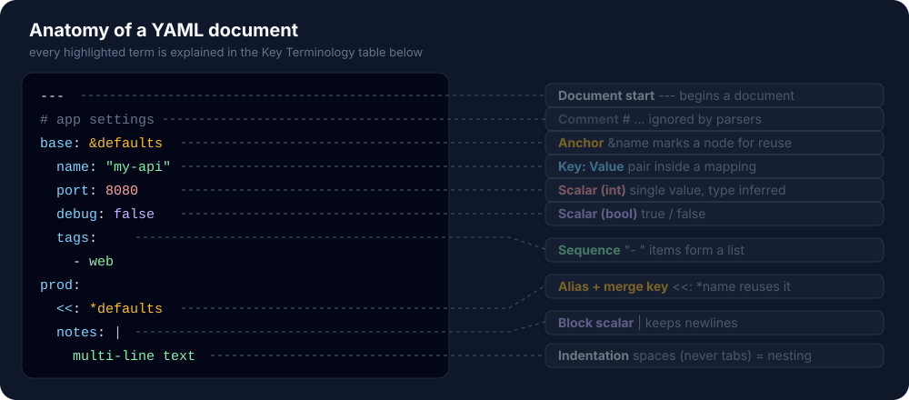

# YAML Anatomy: Every Part of a Document

This diagram takes one small, realistic YAML document apart and labels every piece. Once you can name each part, error messages like "mapping values are not allowed here" stop being scary, because you know exactly which part the parser is complaining about.



[Open the diagram full screen](../assets/yaml-anatomy.svg)

## The document

```yaml
---
# app settings
base: &defaults
  name: "my-api"
  port: 8080
  debug: false
  tags:
    - web
prod:
  <<: *defaults
  notes: |
    multi-line text
```

## Line by line

| Line | Part | What it means |
| --- | --- | --- |
| `---` | **Document start** | Marks the start of a YAML document. Optional for one document, required when one file holds several (like Kubernetes manifests separated by `---`). |
| `# app settings` | **Comment** | Ignored by the parser. Notes for humans only. |
| `base: &defaults` | **Key + anchor** | `base` is a key whose value is the indented block below. `&defaults` puts a label (an **anchor**) on that block so it can be reused. |
| `  name: "my-api"` | **Key: value** | A key/value pair inside the `base` mapping. The quoted value is a **string**. |
| `  port: 8080` | **Scalar (int)** | A single value. No quotes, only digits, so the parser **infers** an integer. |
| `  debug: false` | **Scalar (bool)** | `true` / `false` become real booleans. |
| `  tags:` | **Key with nested value** | No value on the same line, so the value is the indented block below it. |
| `    - web` | **Sequence** | `- ` starts a list item. `tags = ["web"]`. |
| `prod:` | **New top-level key** | It's back at column 0, so it's a sibling of `base`, not a child. |
| `  <<: *defaults` | **Alias + merge key** | `*defaults` is an **alias**: "insert the block labelled `defaults` here". `<<` is the **merge key**: it copies those keys into `prod`. |
| `  notes: \|` | **Block scalar** | `\|` starts a **literal block**: the indented lines below become one string and keep their newlines. |
| `    multi-line text` | **Block content** | The text of `notes`. Its indentation is removed; the value is `"multi-line text\n"`. |

## What `prod` becomes after loading

```yaml
prod:
  name: "my-api"
  port: 8080
  debug: false
  tags: [web]
  notes: "multi-line text\n"
```

The merge copied all of `base` into `prod`. If `prod` also had its own `port: 9090`, the local key would **win** over the merged one. That's how you write "same as defaults, but change this one thing".

## Indentation (the invisible part)

The diagram's last label is the most important one: **indentation is nesting**. Two spaces deeper means "inside the line above". Tabs are not allowed. The parser builds a tree from the indentation alone:

```text
(root)
├── base
│   ├── name, port, debug
│   └── tags → [web]
└── prod
    ├── (merged from base)
    └── notes
```

## Senior engineer notes

- **`<<` merge keys are a YAML 1.1 feature, not part of YAML 1.2.** Docker Compose, PyYAML, js-yaml and Go's yaml.v3 support them, but not every tool does. GitHub Actions, for example, accepts anchors and aliases but not `<<`. Test with the tool that will actually read the file.
- **Anchors only work inside one file.** You can't reference `&defaults` from another YAML file.
- **Prefer `|` for scripts** (shell commands, certificates, SQL) because line breaks matter there. Use `>` for long prose.
- When a config gets hard to read, draw the tree like above. Most "wrong value" bugs are a key sitting one level too high or too low.
