# YAML Data Types: What the Parser Really Gives You

YAML has two kinds of values: **scalars**, which hold one value, and **collections**, which hold many. You rarely write a type. The parser **infers** it from how the value looks, unless you quote it or add a `!!tag`. This guide shows all eight types and exactly what your program receives.



[Open the diagram full screen](../assets/yaml-data-types.svg)

## 1. String (`!!str`)

```yaml
name: Ashutosh     # plain (unquoted) string
msg: "Hi\n"        # double quotes: \n becomes a real newline
raw: 'C:\path'     # single quotes: backslash stays a backslash
```

| Line | Result | Why |
| --- | --- | --- |
| `name: Ashutosh` | `"Ashutosh"` | Doesn't look like a number, bool or null, so it's text. |
| `msg: "Hi\n"` | `"Hi⏎"` | Double quotes process **escapes** (`\n`, `\t`, `\"`). |
| `raw: 'C:\path'` | `"C:\path"` | Single quotes are **literal**: no escapes. Great for Windows paths and regexes. |

## 2. Integer (`!!int`)

```yaml
port: 8080    # decimal → 8080
hex: 0x1F     # hexadecimal → 31
octal: 0o17   # octal (YAML 1.2 style) → 15
```

`0x` means base 16 and `0o` means base 8. You'll see these in file permissions (`mode: 0o644`).

## 3. Float (`!!float`)

```yaml
pi: 3.14     # → 3.14
sci: 1.5e3   # scientific notation → 1500.0
max: .inf    # infinity → ∞  (also -.inf and .nan)
```

## 4. Boolean (`!!bool`)

```yaml
active: true
debug: false
# yes/no = bool in 1.1!
```

Only `true`/`false` are booleans in YAML 1.2. **Older YAML 1.1 parsers also treat `yes`, `no`, `on`, `off`, `y`, `n` as booleans.** This is the famous "Norway problem": `country: NO` became `false`. Quote such values: `country: "NO"`.

## 5. Null (`!!null`)

```yaml
a: null    # → null
b: ~       # → null
c:         # empty → null
```

All three mean "no value". A key with nothing after the colon is null, which explains a lot of "why is my setting null?" bugs caused by bad indentation.

## 6. Timestamp (`!!timestamp`)

```yaml
day: 2026-10-01               # → date
at: 2026-10-01T09:30:00Z      # → datetime (UTC because of Z)
# parser-dependent
```

Some parsers turn these into real `Date` objects and some keep them as strings. **If you need a string, quote it.**

## 7. Sequence / list (`!!seq`)

```yaml
tools:          # block style
  - docker
  - k8s
ports: [80, 443]   # flow style (JSON-like)
```

`tools → ["docker", "k8s"]` and `ports → [80, 443]`. Both styles produce the same thing. Block style is easier to diff in Git; flow style is good for short lists.

## 8. Mapping / dict (`!!map`)

```yaml
user:            # block style
  id: 1
  role: admin
db: {host: local}   # flow style
```

`user → {id: 1, role: "admin"}`. A mapping is an object: unique keys pointing to values.

## Forcing a type

When the guess is wrong, quote the value or tag it:

```yaml
zip: "01234"     # stays a string (unquoted it might become 1234 or 668)
version: !!str 1.10   # "1.10", not the float 1.1
count: !!int "42"     # the integer 42
```

## Senior engineer notes

- **Implicit typing is YAML's #1 source of production bugs.** Quote IDs, versions, zip codes, phone numbers, Git SHAs, and anything with leading zeros.
- **Know your parser's YAML version.** PyYAML is mostly 1.1 (yes/no are booleans); js-yaml and Go's yaml.v3 follow 1.2. The same file can load differently.
- **Check the loaded result, not the file.** For example `python -c "import yaml,sys;print(yaml.safe_load(open(sys.argv[1])))" file.yaml` or `yq -o=json file.yaml` shows what your app will actually see.
