# YAML Spacing Guide: 6 Rules That Fix Most Errors

In YAML, **whitespace is syntax**. A missing space or one extra space changes the meaning of the file, often without an error. These six wrong-vs-right pairs cover most of the mistakes beginners (and tired seniors) make. In the examples, `·` means one space and `→` means a tab.



[Open the diagram full screen](../assets/yaml-spacing-guide.svg)

## Rule 1: Spaces, never tabs

```yaml
# ✗ WRONG
app:
→   name: api        # error: found character '\t'

# ✓ RIGHT
app:
··name: api          # 2 spaces per level
```

**Why:** the YAML spec forbids tabs for indentation, because tab width differs between editors. The parser stops with `found character '\t' that cannot start any token`.
**Fix:** set your editor to insert 2 spaces when you press Tab.

## Rule 2: Space after the colon

```yaml
# ✗ WRONG
port:8080            # → one string "port:8080"

# ✓ RIGHT
port:·8080           # → {port: 8080}
```

**Why:** `: ` (colon + space) is what separates a key from its value. Without the space, the colon is just a character in a longer string. `localhost:3000` in a URL works for the same reason.

## Rule 3: Space after the dash

```yaml
# ✗ WRONG
tools:
··-docker            # → string "-docker", not a list

# ✓ RIGHT
tools:
··-·docker           # → ["docker"]
```

**Why:** a list item is `- ` (dash + space). `-docker` is plain text that happens to start with a dash, the same as a negative number like `-5`.

## Rule 4: Keep siblings aligned

```yaml
# ✗ WRONG
db:
··host: local
···port: 5432        # bad indentation

# ✓ RIGHT
db:
··host: local
··port: 5432
```

**Why:** keys at the same level must start in the **exact same column**. One extra space makes the parser think `port` belongs *inside* `host: local`, which is impossible because `host` already has a value. You get `bad indentation of a mapping entry`.

## Rule 5: Indent children deeper

```yaml
# ✗ WRONG
server:
name: web            # server = null, name is a sibling

# ✓ RIGHT
server:
··name: web          # → {server: {name: web}}
```

**Why:** this one is dangerous because there is **no error**. `server:` with nothing indented below it is `null`, and `name` becomes a separate top-level key. Your app then crashes later with "server is undefined".

## Rule 6: Line up list items

```yaml
# ✗ WRONG
ports:
··- 80
····- 443            # → one item "80 - 443"

# ✓ RIGHT
ports:
··- 80
··- 443
```

**Why:** every `- ` in one list must start in the same column. The deeper `- 443` is read as a continuation of the first item's text, so you get one string `"80 - 443"` instead of two ports. Again: **no error**, just wrong data.

## Rule of thumb

> **2 spaces per level · `key: value` · `- item` · run `yamllint` before you commit.**

## Senior engineer notes

- **Silent bugs are worse than errors.** Rules 5 and 6 don't fail; they produce the wrong data. That's why you lint in CI and check the loaded output.
- Add a `.editorconfig` so every editor on the team uses the same spacing:

  ```ini
  [*.{yml,yaml}]
  indent_style = space
  indent_size = 2
  ```

- Turn on **"Render Whitespace"** in VS Code when debugging YAML. Seeing the dots and arrows makes these bugs obvious.
- `yamllint --strict .` also catches trailing spaces, wrong indentation and duplicate keys.
