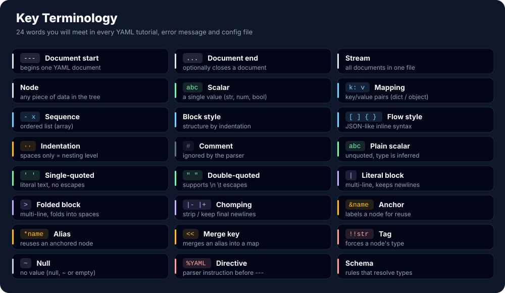

# YAML Terminology: 24 Words Explained Simply

These are the words you'll see in every YAML tutorial, error message and spec. Error messages use exactly these terms ("expected a block mapping", "found undefined alias"), so knowing them makes debugging much faster. Each term has a symbol, a plain-English meaning, and a tiny example.



[Open the diagram full screen](../assets/yaml-terminology.svg)

## Document structure

| Symbol | Term | Plain meaning | Example / when you see it |
| --- | --- | --- | --- |
| `---` | **Document start** | Begins one YAML document. | Kubernetes files with several resources separated by `---`. |
| `...` | **Document end** | Optionally closes a document. | Rare; used when streaming documents over a pipe. |
| | **Stream** | All the documents in one file or input. | `kubectl apply -f all.yaml` reads a stream of documents. |
| | **Node** | Any single piece of data in the tree: a value, a list, or a map. | Error messages: "found duplicate key in node". |

## The three kinds of nodes

| Symbol | Term | Plain meaning | Example |
| --- | --- | --- | --- |
| `abc` | **Scalar** | One single value: string, number, bool, null. | `port: 8080` → `8080` is a scalar. |
| `k: v` | **Mapping** | Key → value pairs (an object / dict). | `db: {host: local}` |
| `- x` | **Sequence** | An ordered list (an array). | `- docker` |

## Two ways to write structure

| Symbol | Term | Plain meaning | Example |
| --- | --- | --- | --- |
| | **Block style** | Structure shown by indentation and new lines. The normal style. | `tools:` then `  - docker` on the next line. |
| `[ ] { }` | **Flow style** | JSON-like inline syntax. | `ports: [80, 443]` |
| `··` | **Indentation** | Spaces only. The number of spaces sets the nesting level. | Two spaces = one level deeper. |
| `#` | **Comment** | Ignored by the parser. | `# why this value is 3` |

## Ways to write a string

| Symbol | Term | Plain meaning | Example |
| --- | --- | --- | --- |
| `abc` | **Plain scalar** | No quotes. The parser **infers** the type. | `name: web` → string, `port: 80` → int. |
| `' '` | **Single-quoted** | Literal text, no escapes. Write `''` for a single quote. | `path: 'C:\temp'` |
| `" "` | **Double-quoted** | Supports escapes like `\n`, `\t`, `\"`. | `msg: "line1\nline2"` |
| `\|` | **Literal block** | Multi-line text that **keeps** newlines. | Shell scripts in CI steps. |
| `>` | **Folded block** | Multi-line text whose newlines **become spaces**. | A long description. |
| `\|-` `\|+` | **Chomping** | Controls the final newline: `-` strips it, `+` keeps all trailing ones, plain `\|` keeps exactly one. | `\|-` for a value that must not end with `\n` (like a token). |

## Reuse

| Symbol | Term | Plain meaning | Example |
| --- | --- | --- | --- |
| `&name` | **Anchor** | Labels a node so it can be reused. | `defaults: &base` |
| `*name` | **Alias** | Reuses the node with that label. | `staging: *base` |
| `<<` | **Merge key** | Copies an aliased map's keys into this map. Local keys win. | `<<: *base` then override one key. |

## Types and rules

| Symbol | Term | Plain meaning | Example |
| --- | --- | --- | --- |
| `!!str` | **Tag** | Forces a node's type instead of letting the parser guess. | `version: !!str 1.10` |
| `~` | **Null** | No value: `null`, `~` or empty. | `proxy: ~` |
| `%YAML` | **Directive** | An instruction to the parser, placed before `---`. | `%YAML 1.2` |
| | **Schema** | The rules that decide types (failsafe, JSON, core). | Why `yes` is a bool in one parser and a string in another. |

## Putting several terms in one example

```yaml
%YAML 1.2            # directive
---                  # document start
# deploy config      # comment
base: &base          # mapping + anchor
  replicas: 2        # plain scalar (int)
  image: "app:1.0"   # double-quoted scalar
prod:
  <<: *base          # merge key + alias
  hosts: [a, b]      # flow-style sequence
  script: |-         # literal block, final newline stripped
    ./deploy.sh
...                  # document end
```

## Senior engineer notes

- When an error message uses a term like "block mapping" or "flow sequence", look it up in these tables. It points straight at the kind of syntax that broke.
- In code review, ask "scalar, mapping or sequence?" about any line that looks odd. Most YAML bugs are one kind of node being read as another.
