# Real-World YAML: Docker Compose for a MERN Stack

This is where everything comes together. One `docker-compose.yml` describes a whole app stack (a React frontend, a Node.js API and a MongoDB database), and one command, `docker compose up -d`, starts all three containers and wires them together. Every line below uses something from the earlier guides.



[Open the diagram full screen](../assets/yaml-use-case-docker-compose.svg)

## The file

```yaml
services:
  web: # React frontend
    image: node:20-alpine
    ports:
      - "3000:3000"
    depends_on:
      - api
  api: # Node.js backend
    build: ./api
    ports:
      - "5000:5000"
    environment:
      MONGO_URL: mongodb://db:27017/app
    depends_on:
      - db
  db: # MongoDB database
    image: mongo:7
    volumes:
      - db-data:/data/db
volumes:
  db-data:
```

## Line by line

### `services:` (the containers)

| Line | What it does |
| --- | --- |
| `services:` | A **mapping** of every container in the app. Each key under it is one service. |
| `  web: # React frontend` | The first service, named `web`. The name also becomes its **hostname** on the internal Docker network. |
| `    image: node:20-alpine` | Use a ready-made image: Node.js 20 on Alpine Linux (small and fast to download). |
| `    ports:` | A **sequence** of port mappings. |
| `      - "3000:3000"` | `HOST:CONTAINER`: your laptop's port 3000 forwards to the container's port 3000. Open `localhost:3000`. |
| `    depends_on:` / `- api` | Start `api` **before** `web`. |

### `api` (the Node.js backend)

| Line | What it does |
| --- | --- |
| `  api: # Node.js backend` | The second service. |
| `    build: ./api` | Instead of pulling an image, **build** one from the `Dockerfile` in the `./api` folder. |
| `      - "5000:5000"` | Expose the API on `localhost:5000`. |
| `    environment:` | A **nested mapping** of environment variables passed into the container. |
| `      MONGO_URL: mongodb://db:27017/app` | The connection string. Note the host is `db`, the service name, not `localhost`. Compose's internal DNS resolves `db` to the database container. |
| `    depends_on:` / `- db` | Start the database before the API. |

### `db` (the database)

| Line | What it does |
| --- | --- |
| `  db: # MongoDB database` | The third service. |
| `    image: mongo:7` | Official MongoDB 7 image. No `ports:`, so it's **only reachable inside** the Docker network. That's a good security default. |
| `    volumes:` / `- db-data:/data/db` | Mount the named volume `db-data` at `/data/db`, where MongoDB stores its files. |

### Top-level `volumes:`

| Line | What it does |
| --- | --- |
| `volumes:` | Declares the named volumes used above. |
| `  db-data:` | A key with an empty (null) value: "create a volume with default settings". It **survives** `docker compose down`, so your data isn't lost when containers restart. |

## What happens when you run it

```bash
$ docker compose up -d
✔ 3 containers started
```

1. Docker reads the YAML and creates a private network for the stack.
2. It starts `db`, then `api` (because of `depends_on`), then `web`.
3. `web` → `localhost:3000`, `api` → `localhost:5000`, `db` → port 27017 inside the network only.

## The YAML you used

| YAML feature | Where it appears |
| --- | --- |
| **Mapping** | `services`, each service, `environment`, `volumes` |
| **Sequence** | `ports`, `depends_on`, `volumes` inside `db` |
| **Nested map** | `environment` inside `api` |
| **Quoted string** | `"3000:3000"` stays a string, not a number |
| **Comments** | `# React frontend` etc. |
| **Null value** | `db-data:` with nothing after it |

## Senior engineer notes

- **Always quote port mappings.** Old YAML 1.1 parsers read unquoted `xx:yy` with small numbers as base-60 numbers (`22:22` becomes `1342`). Docker's own docs say to quote them.
- **`depends_on` controls start order, not readiness.** The API can start before MongoDB accepts connections. Use a `healthcheck` on `db` plus `depends_on: { db: { condition: service_healthy } }`, or retry the connection in your code.
- **Don't commit secrets in `environment:`.** Use an `env_file: .env` (git-ignored) or Docker secrets for passwords and API keys.
- The top-level `version:` key you see in old tutorials is no longer needed with Compose v2.
- Check the merged result with `docker compose config`. It prints exactly what Docker understood from your YAML.
